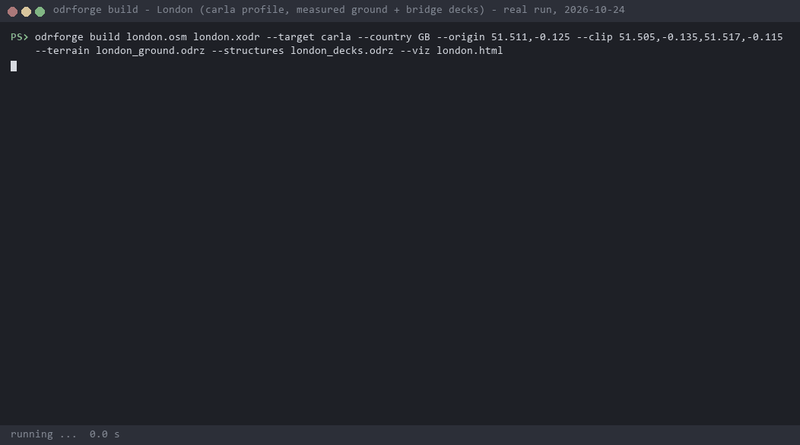
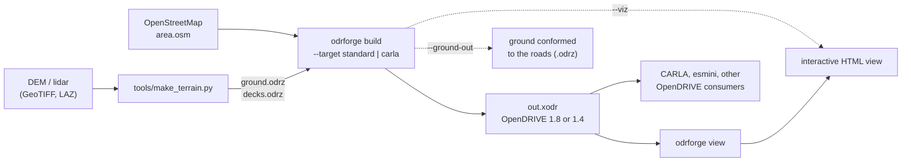
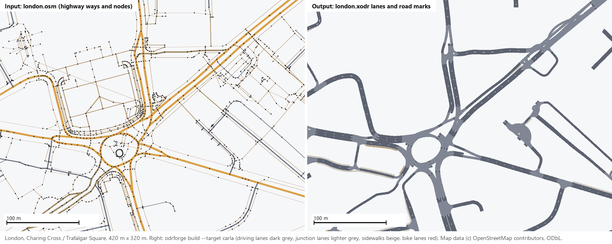
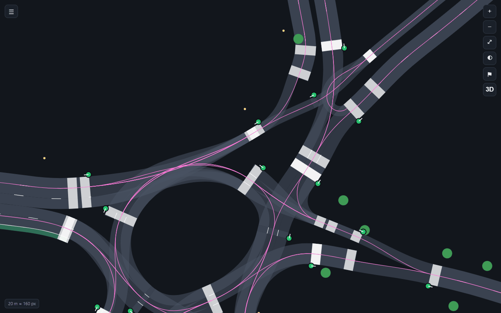
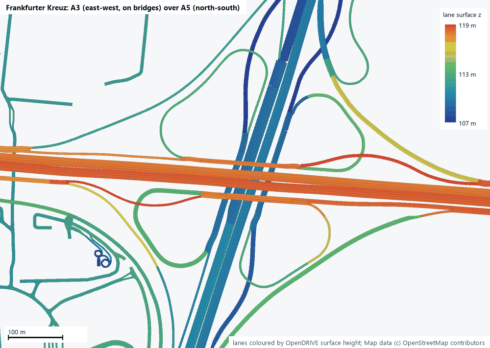
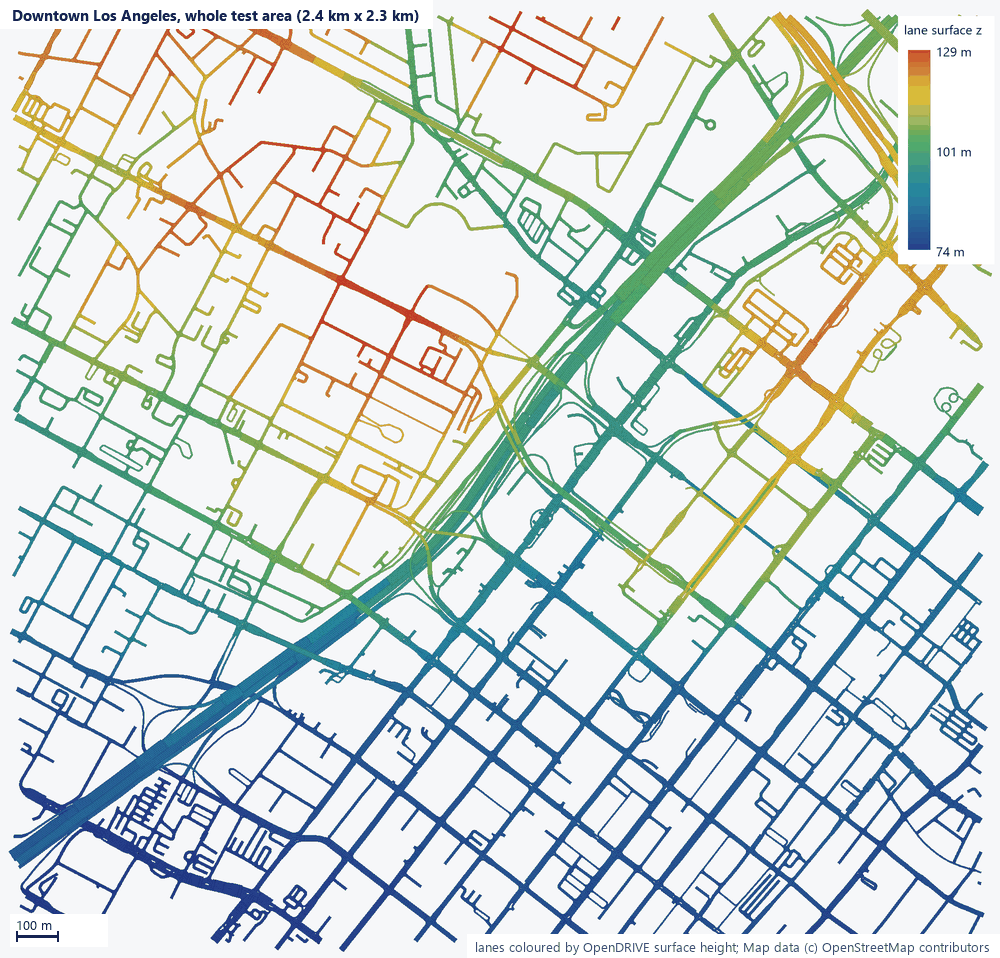
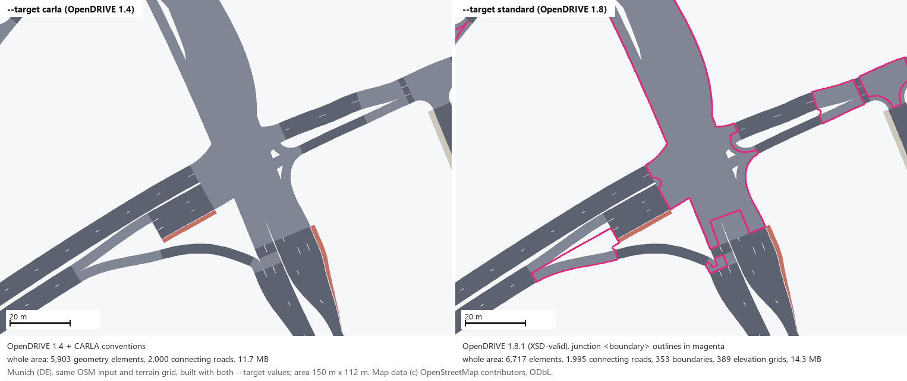
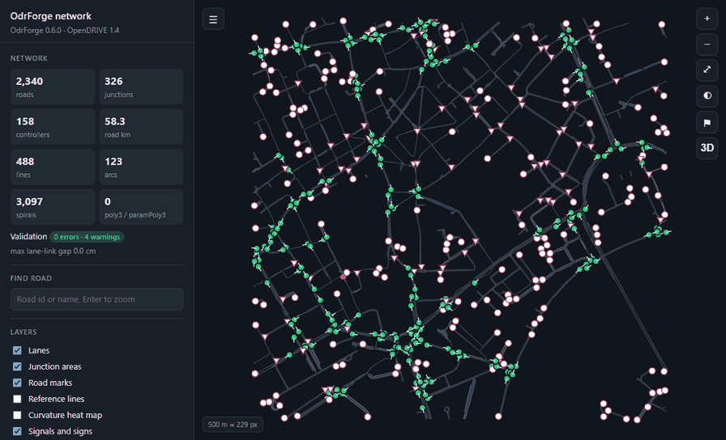

# OdrForge

OdrForge builds ASAM OpenDRIVE road networks from map data; OpenStreetMap is the source it reads today. It is a
C++17 library plus the `odrforge` command-line tool: `odrforge build` makes a network (the source is chosen by
`--from`, or by the input's file extension), `odrforge view` writes an interactive HTML view of any OpenDRIVE file.



*A real `odrforge build` run (odrforge 0.6.0, Release build of `7dbe891`, Windows): the London test area with the
`carla` profile, the measured ground grid and the bridge-deck grid. The GIF is drawn from the captured console output
and keeps its timing: the report appears when the build finishes, after 2.6 s. Footer figures were measured by the
recorder (wall 2.62 s, peak working set 263 MB, exit code 0). The executable path is shortened to `odrforge`.*

- **Standard geometry only.** Reference lines are clothoid splines of `line`, `arc` and `spiral`
  elements, with continuous heading and curvature.
- **Native OpenDRIVE structure.** Roads are two-way. Lane sections taper widths, and `laneOffset`
  follows OSM `placement`. Lane-level connecting roads are built from `turn:lanes` and turn
  restrictions.
- **Simulator-ready traffic assets.** Traffic lights come with controllers that are referenced from
  their junctions. Stop and give-way signs follow OSM direction tags, speed-limit signs appear where
  limits change, and crosswalks, street lamps and trees are placed as objects.
- **Any country.** JSON rule files cover driving side, widths, implicit speeds, marking styles and
  sign catalogues. Included: `XX` (generic), `US`, `CA`, `DE`, `FR`, `GB`, `IN`, `JP`, `AU`.
- **Output profiles.** `standard` (OpenDRIVE 1.8, validated against the 1.8.1 XSD: `walking`
  lanes, lane `direction`, access restriction elements) and `carla` (the OpenDRIVE 1.4 vocabulary
  LibCarla reads, plus CARLA conventions). Each newer feature is written as its documented 1.4
  substitute in `carla`. The older names `asam`, `asam18` and `esmini` mean `standard`.
- **Connected network.** OSM near-misses are joined, and parking lots that link streets are
  driven through. Freeway exits and entrances are lane-level splits and merges at the gore, so road
  surfaces never overlap there.
- **Validated on every run.** Checks cover geometry gaps, lane-level link gaps and headings,
  references and ids.

See [docs/DESIGN.md](docs/DESIGN.md) for the approach and the measured comparison with SUMO
`netconvert`.

## Workflow



1. **Inputs.** An OSM extract of the area and, for real heights, a ground grid and a bridge-deck grid made by
   `tools/make_terrain.py` from an elevation model and lidar. `tools/odrforge_pipeline.py` fetches and builds all of
   them from one TOML file per set of areas; see [docs/PIPELINE.md](docs/PIPELINE.md).
2. **Build.** `odrforge build` writes the `.xodr`, prints a report (counts, fit to the OSM nodes, fit to the measured
   ground, validation) and exits with 1 when validation finds errors (the file is still written).
3. **Look at it.** `--viz` (or `odrforge view` on any OpenDRIVE file) writes one self-contained HTML page.
4. **Use it.** Load the `.xodr` in a simulator or any OpenDRIVE tool; `--ground-out` gives the terrain around the
   roads for 3D scenes.

## In pictures

All images come from real runs of the build above on the six test areas (2026-10-24). The top-down plots were drawn
from the written `.xodr` files with a lane-level OpenDRIVE evaluator (reference line, `laneOffset`, lane widths,
elevation and superelevation); the screenshots are the `odrforge` HTML viewer in headless Chrome. Map data
© OpenStreetMap contributors, ODbL.

### OSM in, lanes out



*London, Charing Cross and Trafalgar Square, 420 m x 320 m. Left: the input, every `highway=*` way of `london.osm`
with its nodes. Right: the lanes of `london.xodr` from
`odrforge build london.osm london.xodr --target carla --country GB --origin 51.511,-0.125 --clip 51.505,-0.135,51.517,-0.115 --terrain london_ground.odrz --structures london_decks.odrz --viz london.html`.
Footways that are mapped as their own ways are not driven roads and are not turned into lanes by default.*

### Junctions and connecting roads



*The same London build in its `--viz` page (dark theme, the Reference lines layer on), 160 m across at Charing Cross.
The magenta lines are reference lines; inside the junction each one is a connecting road for one lane-level turn.
Green markers are traffic lights in a controller, white bars are crosswalks, green and yellow dots are trees and
street lamps. The
London report: 676 roads + 1,626 connecting roads, 326 junctions, 484 signals, 158 controllers, 0 validation errors.*

### Real elevation: bridges and interchanges



*Frankfurter Kreuz, 900 m x 640 m, every lane coloured by its OpenDRIVE surface height (elevation profile plus
superelevation), lowest drawn first. The A3 (east-west, tagged `bridge=yes`, `layer=1` in OSM) crosses the A5
(north-south) about 10 m higher; the loop ramps climb between the two. Built with
`odrforge build frankfurt_kreuz.osm frankfurt_kreuz.xodr --target carla --country DE --origin 50.0525,8.600 --clip 50.045,8.585,50.060,8.615 --terrain frankfurt_kreuz_ground.odrz --structures frankfurt_kreuz_decks.odrz --ground-out frankfurt_kreuz_conformed.odrz`;
its report: 45 freeway splits and merges modelled at lane level, 0 validation errors.*



*The whole Downtown Los Angeles test area (2.4 km x 2.3 km, 1,805 roads + 6,127 connecting roads), coloured by lane
surface height from 74 m to 129 m: the higher ground north-west of the Harbor Freeway (I-110, the wide diagonal)
and the freeway ramps. Built with `odrforge build la_area.osm la.xodr --target carla --country US --origin 34.054,-118.2575 --name LA_DTLA --terrain la_ground.odrz --structures la_decks.odrz --clip 34.044,-118.27,34.064,-118.245`.
The report compares the lane centres with the measured ground: 44,948 samples, mean 0.087 m, p95 0.192 m.*

### Output profiles: `carla` and `standard`



*One Munich junction (150 m x 112 m) from the same OSM file and ground grid, built twice:
`odrforge build munich.osm munich.xodr --target carla|standard --country DE --origin 48.1385,11.5725 --clip 48.132,11.560,48.145,11.585 --terrain munich_ground.odrz`.
`standard` adds the OpenDRIVE 1.8 junction `<boundary>` (magenta) and junction elevation grids, and writes `walking`
lanes with `curb` lanes beside them where `carla` writes `sidewalk` lanes. Whole-area figures are from the two build
reports and file sizes.*

| Munich, whole area | `--target carla` | `--target standard` |
|---|---|---|
| OpenDRIVE version | 1.4 + CARLA conventions | 1.8 (1.8.1 XSD) |
| roads + connecting roads | 794 + 2,000 | 794 + 1,995 |
| geometry elements | 5,903 | 6,717 |
| junction boundaries / elevation grids | none | 353 / 389 |
| roads starting and ending in one junction | 9 cut in two (2 with no place to cut) | not cut |
| file size | 11.7 MB | 14.3 MB |
| build time, wall (this run) | 3.7 s | 4.6 s |

### The viewer



*`london.html` from the London build, driven with real mouse input in headless Chrome (Playwright): the whole area,
wheel zoom to Charing Cross, hover inspection of a lane, a click to pin its road, the Reference lines layer, then a
closer zoom and a pan. The page works offline. Its 3D button (lanes at their OpenDRIVE heights) loads
three.js from a CDN and is not shown here.*

## Performance

Measured for the perf-memory merge (`168b1b2` -> `7dbe891`), best of 3, runs interleaved, peak working set; output
byte-identical apart from the header date. See [CHANGELOG.md](CHANGELOG.md).

| area (carla / standard) | before | after |
|---|---|---|
| Los Angeles | 23.3 s / 24.8 s, 11.7 GB | 8.4 s / 10.2 s, 1.35 GB / 1.36 GB |
| Munich | 6.3 s / 7.2 s, 0.8 GB | 3.2 s / 4.1 s, 0.37 GB |
| London | 5.1 s / 6.0 s, 0.54 GB | 2.6 s / 3.2 s, 0.27 GB |
| Frankfurt | 12.5 s / 19.0 s, 0.93 GB | 4.1 s / 4.8 s, 0.39 GB |
| Stelvio | 7.3 s / 7.4 s, 251 MB | 0.9 s / 1.0 s, 62 MB / 70 MB |
| Tokyo (no terrain) | 8.1 s / 9.2 s | 3.1 s / 4.2 s |

## Build (Windows, MSVC 2022)

```bat
build.bat Release
```

On other platforms:

```bash
cmake -S . -B build -DCMAKE_BUILD_TYPE=Release && cmake --build build && ctest --test-dir build
```

Dependencies (pugixml and nlohmann/json) are fetched at configure time and pinned by SHA-256.

## Use

```bat
odrforge build area.osm out.xodr --country US --target carla --origin 34.054,-118.2575
```

```cpp
#include <odrforge/network.hpp>
using namespace odrforge;
OsmData osm = OsmData::readXml("area.osm");
BuildOptions opt;
opt.country = CountryProfile::load("DE");
opt.target = TargetProfile::byName("standard");
opt.elevation = [&](double x, double y) { return dem.height(x, y); };  // optional terrain
BuildReport rep;
odr::OpenDrive od = buildOpenDrive(osm, Projection(lat0, lon0), opt, &rep);
odr::write(od, "out.xodr", {opt.target.revMinor});
```

### Real elevation

```bat
python tools\make_terrain.py --origin 34.054,-118.2575 --bounds 34.044,-118.27,34.064,-118.245 ^
    --dem usgs_1m.tif --lidar tile.laz --ground ground.odrz --structures decks.odrz --datum NAVD88
odrforge build area.osm out.xodr --country US --target carla --origin 34.054,-118.2575 ^
    --terrain ground.odrz --structures decks.odrz --clip 34.044,-118.27,34.064,-118.245
```

Roads follow the measured ground, and bridges follow their measured decks. Roads under another
road keep 4.5 m clearance. Each junction is one plane shared by all its connecting roads, and
crossfall is written as `superelevation`. Pass `--no-superelevation` for consumers that ignore it.
The vertical datum of the grids is recorded in the header `userData`. See
[docs/DESIGN.md](docs/DESIGN.md#real-elevation-elevationcpp).

## Verify against the map and imagery

```bat
python tools\make_basemap.py --origin 34.054,-118.2575 --bounds 34.044,-118.27,34.064,-118.245 ^
    --out out_basemap --osm area.osm --naip
odrforge build area.osm out.xodr ... --viz out.html --basemap out_basemap
```

The viewer's Background selector then offers:
- an HD map rendered from the OSM file,
- USGS NAIP satellite imagery (offline, 0.6 m),
- live Esri imagery.

All of them are placed in the network's own projection, under the roads. A path on the map with no
lanes over it, or lanes beside the street in the imagery, is a difference to look at.

## Visualise

```bat
odrforge build area.osm out.xodr --country US --viz out.html
odrforge view any.xodr view.html
```

Both commands write one self-contained HTML file. Nothing is fetched from the web unless you turn
on the optional OpenStreetMap layer (tiles placed with the file's projection, to compare the
generated roads with the map):
- pan and zoom, plus layer toggles: lanes by type, junction areas, road marks, reference lines,
  curvature heat map, signals, objects
- hover and click inspection of lanes and roads, and road search
- the validation status of the file

## Conformance

`validate()` checks the ASAM OpenDRIVE rules listed in `src/validate.cpp`. Every message carries the
ASAM rule id or the spec section it enforces. The test suite (`ctest`) runs the formulas, writer,
reader and 9 end-to-end OSM scenarios against these rules.

## Compared with SUMO netconvert

[OdrForge vs SUMO netconvert](https://claude.ai/artifact/PMxFJbbrvoZbmRWSTRnrV2): a head-to-head on the six OSM
test areas, measured on 2026-10-20 at commit `2fa2fda` against SUMO netconvert 1.28.0. It is judged mainly by
CARLA's own map parser: in five areas, 390 position jumps over 1.6 m against SUMO's 15,130. It also covers the
OpenDRIVE schema (0 errors against 144 to 8,739 per area) and London's kerb lines. Where SUMO is ahead: speed,
smoother junction interiors and mountain hairpins. The page is private to its owner until shared.

## Versioning

The library follows [Semantic Versioning](https://semver.org/). The version lives in `VERSION` and
is exposed as `ODRFORGE_VERSION` (`<odrforge/version.hpp>`). It is written into the OpenDRIVE header
`vendor` attribute so every file records the generator version. Releases are git tags `vX.Y.Z`; see
[CHANGELOG.md](CHANGELOG.md).

## License

Proprietary. See [LICENSE](LICENSE).
